# Azure: Eyes Wide Shut Write-up

**Platform**: TryHackMe <br>
**Room**: Azure: Eyes Wide Shut (https://tryhackme.com/room/eyeswideshut) <br>
**Category**: Cloud | Azure <br>
**Target**: Microsoft Azure / Linux Virtual Machine <br>
**Techniques**: Azure Enumeration, Managed Identity Abuse, RBAC Privilege Escalation, Key Vault Enumeration, Sensitive Data Exposure <br>
**Final Goal**: Retrieve the Azure Key Vault flag

## Executive Summary

This assessment evaluated the security of an Azure environment containing a Linux virtual machine and associated cloud resources. The objective was to determine whether an attacker possessing a compromised password could leverage the available access and identity permissions to move laterally within the Azure tenant and access sensitive information.

The assessment identified an over-permissioned Managed Identity assigned to the Linux virtual machine. By authenticating through the Managed Identity and enumerating its Azure Role-Based Access Control (RBAC) assignments, it was possible to identify the Owner role. This permission provided the ability to assign additional roles, including `Key Vault Administrator`, enabling access to secrets stored in an Azure Key Vault.

The assessment demonstrates the security implications of excessive permissions assigned to workload identities. Although Managed Identities eliminate the need to store credentials within applications and virtual machines, their permissions must be carefully restricted to prevent an attacker who compromises a workload from inheriting excessive access to cloud resources.

## Overview

Eyes Wide Shut simulates an Azure cloud environment where an attacker has obtained a compromised password and must investigate the available resources, identities, and permissions within the tenant.

The objective is to establish access to the provided Linux virtual machine, identify its associated Managed Identity, enumerate the permissions assigned to that identity, and determine whether those permissions can be leveraged to access sensitive Azure resources.

The room demonstrates an attack chain involving:
- Azure resource enumeration
- Linux virtual machine discovery
- SSH authentication
- Azure CLI installation
- Managed Identity authentication
- Managed Identity enumeration
- Azure resource enumeration
- Role-Based Access Control (RBAC) enumeration
- Excessive permissions identification
- Azure RBAC role assignment
- Key Vault enumeration
- Sensitive secret retrieval

## Attack Chain

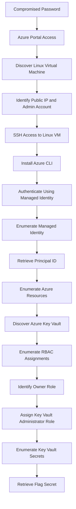

## Azure Cloud Concepts

Before proceeding with the assessment, several Azure concepts are relevant to understanding the attack path.

### Managed Identities

A Managed Identity is an identity provided and managed by Microsoft Entra ID for Azure resources. It allows services such as virtual machines and applications to authenticate to other Azure services without requiring manually managed credentials.

Instead of storing passwords or service principal secrets, an Azure resource can request access tokens through its Managed Identity. These tokens can then be used to authenticate to other Azure resources, depending on the permissions assigned to the identity.

Managed Identities are available in two forms:
- **System-assigned**: Created specifically for an Azure resource and automatically deleted when that resource is removed.
- **User-assigned**: Created independently and can be associated with multiple Azure resources.

In this assessment, the Linux virtual machine had an associated Managed Identity that could be used to authenticate to Azure.

### Role-Based Access Control (RBAC)

Azure Role-Based Access Control is the authorization mechanism used to determine which identities can perform specific actions on Azure resources.

Permissions are assigned through role assignments, which associate:
- A security principal, such as a user or Managed Identity.
- A role defining the permitted actions.
- A scope defining the resources to which the permissions apply.

Some relevant built-in Azure roles include:

| Role | Description |
|------|-------------|
|Reader|Allows viewing Azure resources without modifying them.|
|Contributor| Allows creating and managing Azure resources, but does not grant permission to assign RBAC roles.|
|Owner|Provides full management access to resources within the assigned scope, including the ability to assign Azure RBAC roles.|
|Key Vault Administrator|Provides full access to Key Vault data-plane operations, including managing and retrieving secrets, keys, and certificates.|

An identity with excessive RBAC permissions can become a significant security risk if an attacker compromises the resource or workload associated with that identity.

### Azure Key Vault

Azure Key Vault is a cloud service designed to securely store and manage sensitive information, including:
- Passwords
- API keys
- Certificates
- Connection strings
- Application secrets

Access to Key Vault is controlled through authorization mechanisms, including Azure RBAC. Depending on the configured permission model, an identity must have the appropriate permissions to retrieve stored secrets.

## Initial Enumeration

The assessment began by accessing the Azure Portal using the provided TryHackMe account.

From the Azure Portal dashboard, the `All resources` section was opened to enumerate the resources available within the tenant. The resource listing revealed a Linux virtual machine `LinuxVM` belonging to the resource group `rg-11226558`.

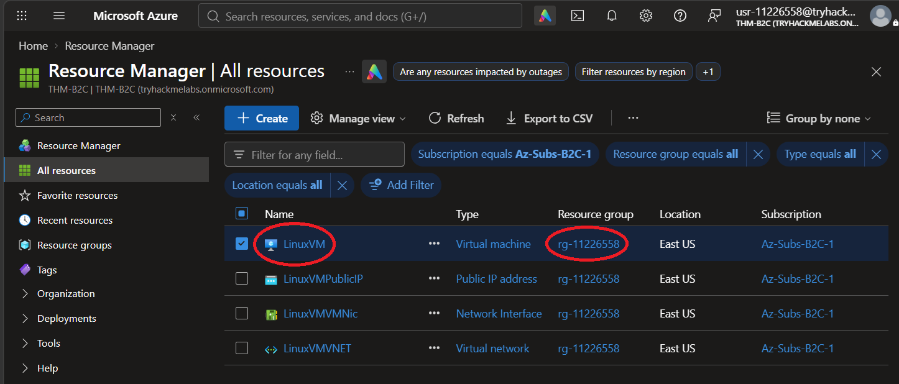

## Linux Virtual Machine Discovery

After selecting the virtual machine, the `Connect` section provided information required to establish remote access.

The following details were identified:

| Property | Value |
|----------|-------|
|Resource Group|rg-11226558|
|Username|admin|
|Public IP Address|20.106.158.132|

The virtual machine was accessible through SSH using the compromised password discovered during reconnaissance.

Rather than connecting directly from the local machine, Azure Cloud Shell was selected as the environment for establishing the SSH session.

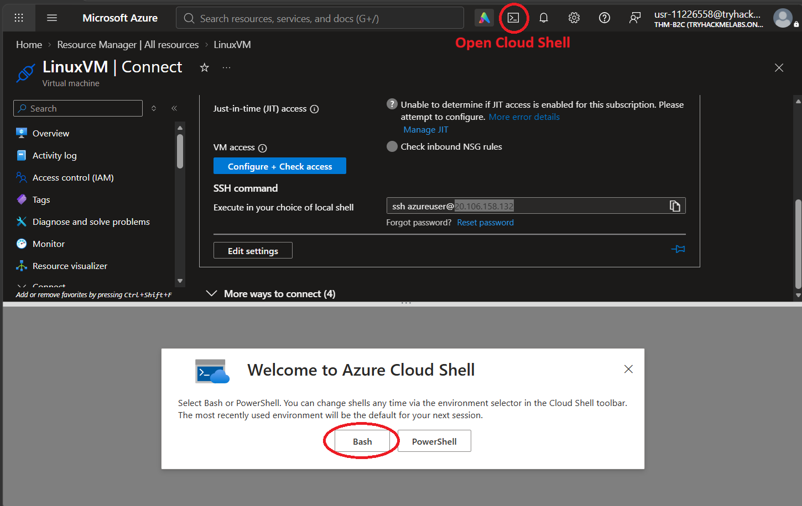

Azure Cloud Shell provides a browser-accessible command-line environment supporting both Bash and PowerShell. Bash was selected, and the existing Azure cloud subscription was selected when prompted.

## Initial Access – SSH Authentication

With the public IP address and administrative username identified, an SSH connection was established to the Linux virtual machine using the compromised credentials. The SSH connection provided access to the underlying operating system.

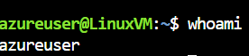

At this stage, authentication to the Linux virtual machine had been successfully established. However, this did not automatically provide an authenticated Azure CLI session.

The next step was to identify whether the virtual machine had an associated Azure identity that could be used to interact with other resources within the tenant.

## Azure CLI Installation

To interact with Azure services from the Linux virtual machine, Microsoft's command-line tool, Azure CLI, was installed.

The following command was executed:

```bash
curl -sL https://aka.ms/InstallAzureCLIDeb | sudo bash
```

The command downloads and executes Microsoft's Azure CLI installation script.

Its components are:
- `curl`: Retrieves the installation script from the specified URL.
- `-s`: Enables silent mode, suppressing progress output.
- `-L`: Follows HTTP redirects.
- `|`: Pipes the downloaded script directly into the next command.
- `sudo bash`: Executes the script using Bash with elevated privileges.

The installation enabled interaction with Azure services directly from the virtual machine.

## Managed Identity Authentication

After installing Azure CLI, the next step was to authenticate to Azure using the virtual machine's Managed Identity.

A Managed Identity is an Azure-managed identity associated with a resource, such as a virtual machine. It allows the resource to obtain authentication tokens without requiring manually configured usernames, passwords, or application secrets.

When an attacker gains access to a virtual machine with an assigned Managed Identity, the identity may become an alternative route into the Azure environment. The permissions available through that identity depend on its assigned roles.

The following command was executed:
 ```bash
az login --identity
```

Command breakdown:
- `az`: Invokes Azure CLI.
- `login`: Initiates authentication to Azure.
- `--identity`: Uses the Managed Identity associated with the Azure resource instead of interactive username/password authentication.

Azure CLI successfully authenticated using the virtual machine's Managed Identity and obtained an `access token`, saved in the background.

Subsequent Azure CLI commands could then use the authenticated identity together with the background-stored token to interact with resources for which it had sufficient permissions.

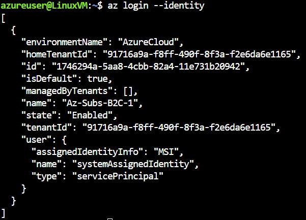

## Managed Identity Enumeration

Following successful authentication, the next step was to identify the Managed Identity associated with the Linux virtual machine.

The following command was executed:

```bash
az vm identity show -g rg-11226558 -n LinuxVM
```

Command breakdown:
- `az vm identity show`: Displays the identity configuration associated with a virtual machine.
- `-g`: Specifies the resource group containing the virtual machine.
- `-n`: Specifies the virtual machine name.

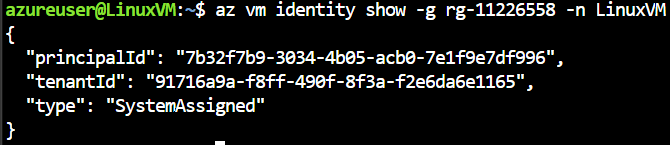

The command returned the identity configuration, including the following Principal ID: `7b32f7b9-3034-4b05-acb0-7e1f9e7df996`.

The Principal ID is a unique identifier associated with the security principal in Microsoft Entra ID. Azure uses this identifier to associate role assignments and permissions with the Managed Identity.

Identifying the Principal ID was important because it allowed the permissions assigned to the virtual machine's identity to be enumerated.

## Azure Resource Enumeration

With the Managed Identity identified, the next step was to enumerate the Azure resources accessible within the virtual machine's resource group.

The following command was executed:

```bash
az resource list -g rg-11226558 -o table
```

Command breakdown:
- `az resource list`: Enumerates Azure resources.
- `-g`: Restricts the results to the specified resource group.
- `-o table`: Formats the results as a readable table.

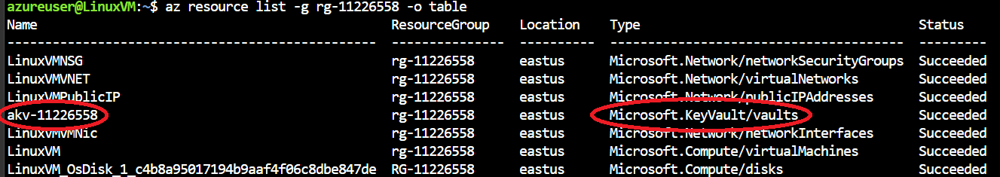

The enumeration revealed several Azure resources, including a Key Vault named `akv-11226558`.

The discovery of the Key Vault was particularly relevant because it could contain sensitive information such as credentials, application secrets, or other confidential data.

However, identifying the resource did not automatically grant access to its contents. The permissions assigned to the Managed Identity needed to be examined first.

## RBAC Permission Enumeration

Azure uses Role-Based Access Control (RBAC) to assign permissions to users, groups, service principals, and Managed Identities.

Depending on the assigned role and its scope, an identity may be able to perform actions such as viewing resources, modifying infrastructure, assigning additional permissions, or accessing sensitive data.

To determine the permissions associated with the identified Managed Identity, the following command was executed:

```bash
az role assignment list --assignee 7b32f7b9-3034-4b05-acb0-7e1f9e7df996 --all -o table
```

Command breakdown:
- `az role assignment list`: Enumerates Azure RBAC role assignments.
- `--assignee`: Specifies the security principal whose permissions are being investigated. In this case, the Managed Identity's Principal ID.
- `--all`: Includes role assignments across the available scopes.
- `-o table`: Displays the results in a readable table.

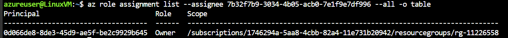

The results revealed that the Managed Identity had been assigned the `Owner` role.

This was a significant finding. The `Owner` role provides full management access to resources within its assigned scope, including the ability to create and manage Azure RBAC role assignments.

Consequently, an attacker controlling the Managed Identity could potentially grant additional permissions to that identity, depending on the scope of the existing assignment.

In this environment, the `Owner` permission provided the necessary authorization to assign the `Key Vault Administrator` role.

## RBAC Privilege Escalation - `Key Vault Administrator`

The identified `Owner` permission provided an opportunity to expand the Managed Identity's access to the Azure environment.

The next operation assigned the Key Vault Administrator role to the same Principal ID.

The following command was executed:

```bash
az role assignment create --role "Key Vault Administrator" --assignee 7b32f7b9-3034-4b05-acb0-7e1f9e7df996 --scope /subscriptions/1746294a-5aa8-4cbb-82a4-11e731b20942/resourcegroups/rg-11226558
```

Command breakdown:
- `az role assignment create`: Creates a new Azure RBAC role assignment.
- `--role`: Specifies the role to assign. In this case, Key Vault Administrator.
- `--assignee`: Identifies the security principal receiving the permissions through its Principal ID.
- `--scope`: Defines the scope at which the role assignment applies.

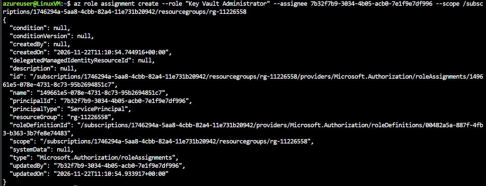

The specified scope corresponds to the resource group `rg-11226558` within the subscription. It is not a subscription-wide assignment. 
The newly created role assignment provided the Managed Identity with `Key Vault Administrator` permissions at the specified resource group scope. 
This role grants extensive access to Key Vault data-plane operations, including retrieving stored secrets.

The permission expansion made it possible to enumerate and retrieve secrets from the previously identified Key Vault.

## Key Vault Secret Enumeration

With the additional permissions assigned, the next step was to enumerate the secrets stored within the Key Vault.

The following command was executed:

```bash
az keyvault secret list --vault-name akv-11226558 --query "[].name" -o tsv
```

Command breakdown:
- `az keyvault secret list`: Enumerates the secrets stored in an Azure Key Vault.
- `--vault-name`: Specifies the target Key Vault.
- `--query "[].name"`: Uses a JMESPath query (a query language specific to JSON documents) to return only the names of the stored secrets.
- `-o tsv`: Formats the output as tab-separated values, providing a simple text representation.

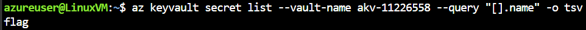

The enumeration revealed a secret named `flag`. Since the secret name indicated that it contained the objective of the room, the next step was to retrieve its value.

## Key Vault Secret Retrieval

The final step involved retrieving the contents of the `flag` secret.

The following command was executed:

```bash
az keyvault secret show --vault-name akv-11226558 --name flag --query value -o tsv
```

Command breakdown:
- `az keyvault secret show`: Retrieves information about a specific Key Vault secret.
- `--vault-name`: Specifies the target Key Vault.
- `--name`: Identifies the secret to retrieve.
- `--query value`: Extracts only the secret's value from the returned JSON object.
- `-o tsv`: Displays the value as plain text.

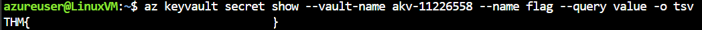

The command successfully returned the contents of the `flag` secret.

The assessment demonstrated that the over-permissioned Managed Identity provided a path to additional Azure privileges, ultimately enabling access to sensitive information stored in the Key Vault.

## Conclusion

The assessment demonstrated how a compromised virtual machine could provide an entry point into an Azure environment through its associated Managed Identity.

After establishing SSH access, the Managed Identity was used to authenticate to Azure without requiring additional credentials. Enumeration revealed that the identity had been assigned the Owner role, providing excessive permissions and the ability to create additional RBAC role assignments.

By assigning the `Key Vault Administrator` role, access to the previously identified Key Vault was obtained, allowing the stored `flag` secret to be retrieved.

The attack path highlights the risks associated with excessive permissions assigned to workload identities. Although Managed Identities provide a secure alternative to manually managed credentials, compromising a resource that possesses an over-privileged identity can expose other resources within the Azure environment.

Ultimately, the assessment demonstrated that cloud security depends not only on protecting user credentials and virtual machines, but also on enforcing appropriate identity permissions and limiting the scope of access granted to workloads.

## Remediation Recommendations

The following recommendations should be implemented to reduce the risk of Managed Identity abuse and excessive permissions within Azure environments.

| Finding | Recommendation |
|---------|----------------|
| **Over-permissioned Managed Identity** | Apply the principle of least privilege when assigning permissions to Managed Identities. Grant only the roles and actions required for the workload to operate. |
| **Excessive Owner permissions** | Avoid assigning the Owner role to application and virtual machine identities unless strictly necessary. Prefer narrower roles such as Reader or Contributor where appropriate. |
| **Unrestricted RBAC role assignment capabilities** | Restrict the ability to create and modify role assignments to dedicated administrative identities. Regularly review permissions that grant `Microsoft.Authorization/roleAssignments/write.` |
| **Excessive Key Vault permissions** | Assign Key Vault permissions at the narrowest possible scope. Use the Key Vault RBAC data roles required by each workload rather than granting broad administrative access. |
| **Managed Identity exposure** | Treat access to virtual machines and other Azure workloads as access to their associated cloud identities. Apply strong host security controls and restrict access to managed identity token endpoints where appropriate. |
| **Insufficient identity monitoring** | Enable Microsoft Entra ID and Azure Activity Log monitoring to detect unusual authentication activity, privilege changes, and unexpected role assignments. |
| **Inadequate RBAC auditing** | Regularly review role assignments across subscriptions and resource groups. Identify unused, excessive, and unnecessarily broad permissions. |
| **Sensitive information stored in Key Vault** | Restrict secret retrieval to explicitly authorized identities and monitor access to sensitive secrets. Rotate credentials if unauthorized access is suspected. |
| **Excessive resource scope** | Assign permissions at the individual resource level whenever possible instead of granting access across entire resource groups or subscriptions. |
| **Lack of workload isolation** | Separate workloads and sensitive resources into appropriately scoped resource groups and subscriptions, reducing the potential impact of a compromised virtual machine. |