# Azure: Tapper Write-up

**Platform**: TryHackMe <br>
**Room**: Azure: Tapper ([https://tryhackme.com/room/tapper](https://tryhackme.com/room/tapper)) <br>
**Category**: Cloud | Azure <br>
**Target**: Microsoft Azure tenant and Linux Virtual Machine <br>
**Techniques**: Azure Resource Enumeration, Microsoft Entra ID Enumeration, Application Credential Abuse, Temporary Access Pass Abuse, Azure RBAC Abuse, Network Security Configuration, Lateral Movement <br>
**Final Goal**: Obtain SSH access to `VM1` and retrieve the flag.

## Executive Summary

The assessment identified an Azure attack path involving an application registration and multiple overprivileged user accounts.

Initial reconnaissance revealed a Linux virtual machine without a public IP address, as well as three Microsoft Entra ID users with different Azure permissions. The compromised password obtained during reconnaissance provided access to the `Gumby` account, which owned an application registration named `Tapper`.

The application had the `UserAuthenticationMethod.ReadWrite.All` Microsoft Graph application permission. By adding a client secret to the application registration, an application-only access token was obtained. This token was then used to create Temporary Access Passes (TAPs) for the `Goo` and `Pokey` accounts.

The `Goo` account's `Network Contributor` permissions allowed network configuration changes that enabled SSH connectivity to the virtual machine. The `Pokey` account's `Virtual Machine Data Access Administrator` permissions allowed the assignment of a VM login role. These changes ultimately enabled SSH access to `VM1` and retrieval of the flag.

## Overview

The environment contained an Azure Linux virtual machine named `VM1`, together with its network interface, `VM1VMNic`. Both resources belonged to the resource group `rg-11241551`.

Three Microsoft Entra ID users were identified:
- `Goo` (`goo@201618.onmicrosoft.com`)
- `Gumby` (`gumby@201618.onmicrosoft.com`)
- `Pokey` (`pokey@201618.onmicrosoft.com`)

Their permissions provided different opportunities for lateral movement:
- `Goo` had the `Network Contributor` role, allowing management of network resources.
- `Gumby` owned the `Tapper` application registration and could manage its credentials.
- `Pokey` had the `Virtual Machine Data Access Administrator` role, allowing management of VM login access through supported role assignments.

The application registration's Microsoft Graph permissions provided a way to create Temporary Access Passes for other users. These accounts could then be used to perform network and virtual machine access operations.

## Attack Chain

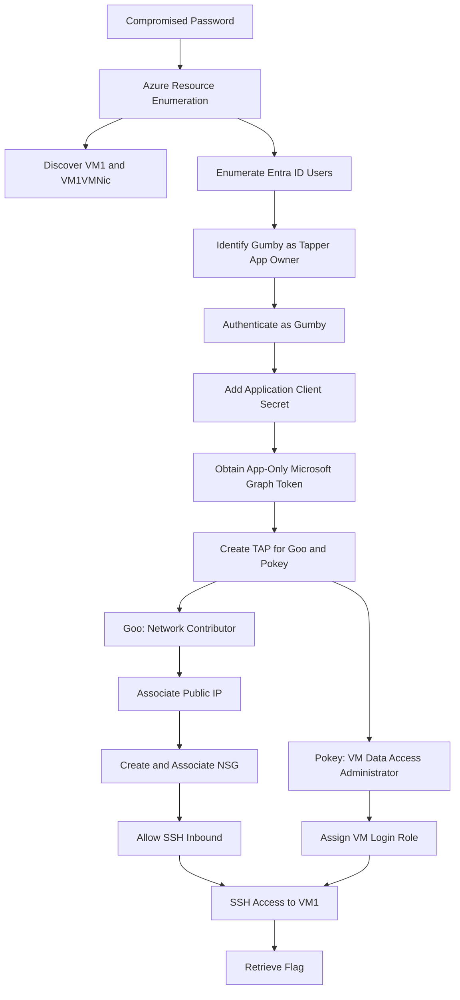

## Azure Resource Enumeration

The first step involved enumerating the resources available through the Azure Portal.

From the dashboard, the `All resources` section provided an overview of the resources accessible to the authenticated account.

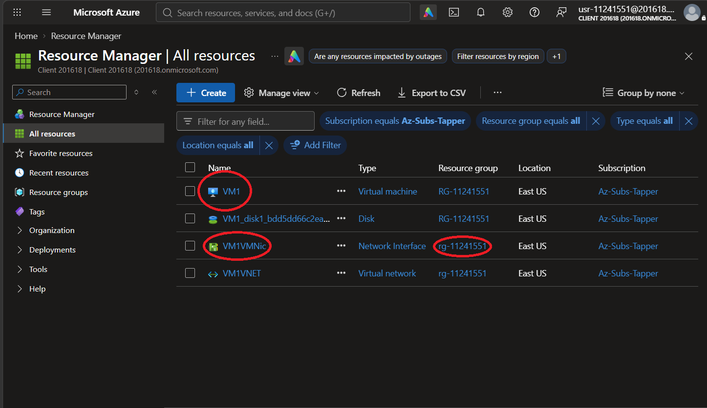

A virtual machine named `VM1` and its associated network interface, `VM1VMNic`, were discovered. Both resources belonged to the resource group `rg-11241551`.

The next step involved inspecting the virtual machine's connection details.

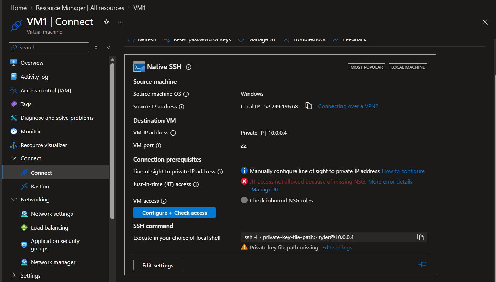

The virtual machine did not have a public IP address associated with its network interface. Consequently, direct SSH access from an external machine was not possible through a public endpoint.

## Microsoft Entra ID User Enumeration

Since direct access to the virtual machine was unavailable, the investigation continued by examining the users in the tenant.

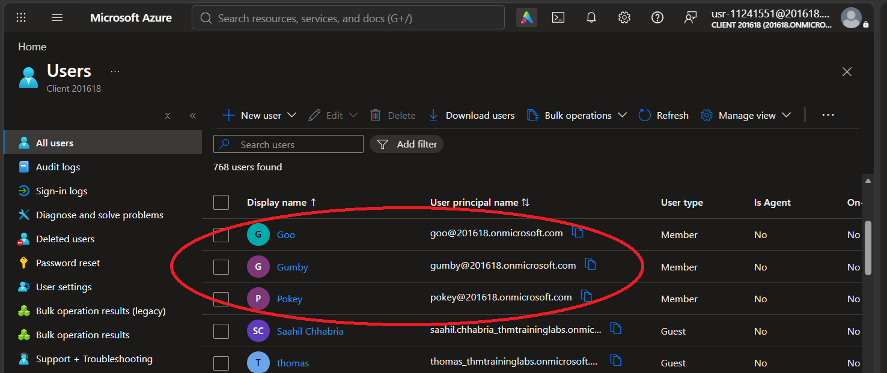

Three accounts were identified:

| User | Account |
|------|---------|
| `Goo` | `goo@201618.onmicrosoft.com` |
| `Gumby` | `gumby@201618.onmicrosoft.com` |
| `Pokey` | `pokey@201618.onmicrosoft.com` |

Their assigned permissions were inspected to identify potential attack paths.

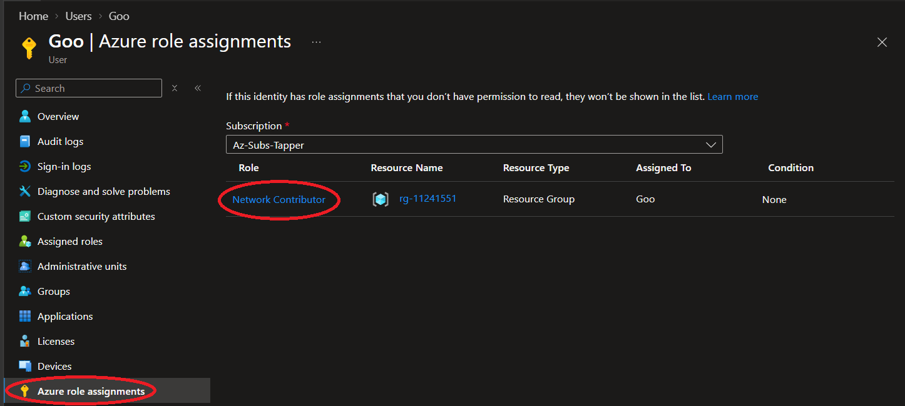

The `Goo` account had the `Network Contributor` role. This role allows management of Azure networking resources, including virtual networks, subnets, network interfaces, route tables, Network Security Groups, and load balancers.

Although this role does not directly provide access to the operating system of a virtual machine, its network-management capabilities can be used to change how the VM is exposed and accessed.

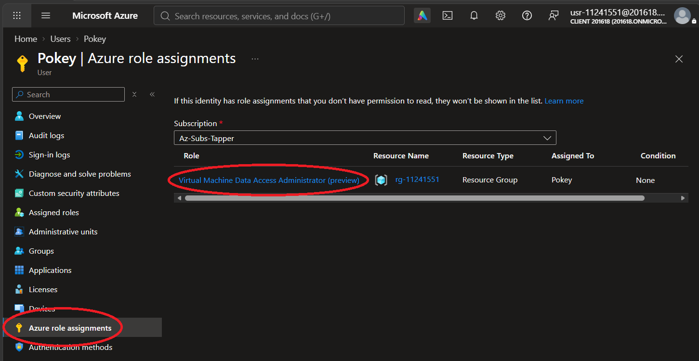

The `Pokey` account had the `Virtual Machine Data Access Administrator` role. This role allows the management of virtual machine login access through supported Azure RBAC role assignments. It is particularly relevant when granting users the ability to authenticate to virtual machines through Microsoft Entra ID.

## Enumerating the `Tapper` Application Registration

The investigation continued with the `App registrations` section of Microsoft Entra ID.

An application named `Tapper` was discovered.

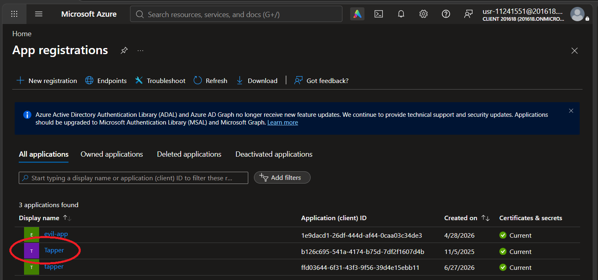

An App Registration represents an application identity in Microsoft Entra ID. It defines how an application authenticates and which permissions it can request when accessing Microsoft services and APIs.

The application's API permissions were inspected.

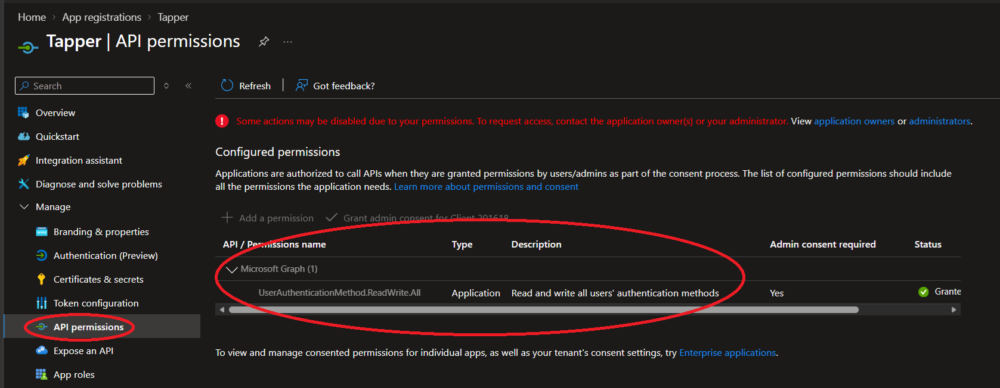

The application had the following Microsoft Graph permission `UserAuthenticationMethod.ReadWrite.All`. This is an application permission that allows an application to read and modify authentication methods for users, subject to the required consent and tenant configuration. Examples of authentication methods that can be managed include:
- Adding or removing supported MFA authentication methods.
- Managing Temporary Access Passes.
- Modifying other supported user authentication methods.

A Temporary Access Pass (TAP) is a time-limited authentication method in Microsoft Entra ID. It acts as a temporary credential that can be used for authentication, account recovery, or onboarding. Depending on its configuration, it can be used once or multiple times during its validity period.

The owner of the application registration was then identified.

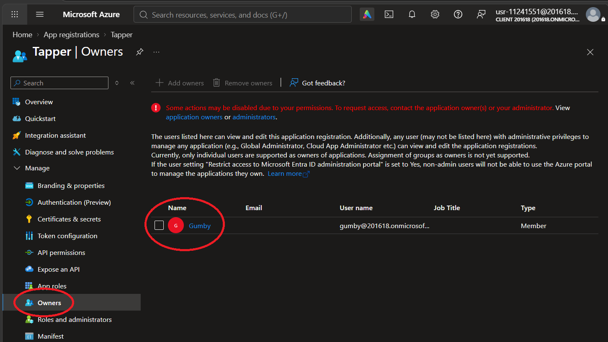

The owner was the `Gumby` account. Since the compromised password obtained during reconnaissance was available, this account became the next target.

## Authenticatig as `Gumby`

Azure Cloud Shell was used to authenticate as `Gumby` through Azure CLI. The following command was executed:

```bash
az login --username gumby@201618.onmicrosoft.com --allow-no-subscriptions
```

Command breakdown:
- `az login`: Starts the Azure CLI authentication process.
- `--username`: Specifies the Microsoft Entra ID account.
- `--allow-no-subscriptions`: Allows authentication even when the account does not have access to an Azure subscription.

The password supplied during reconnaissance was accepted, allowing authentication as Gumby.

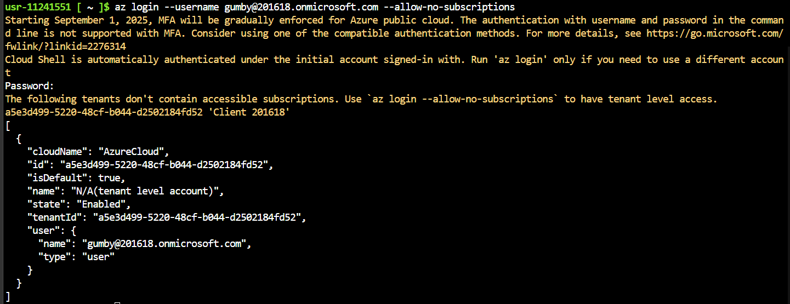

## Retrieving the `Tapper` Application ID

After authenticating as `Gumby`, the Tapper application registration was enumerated to retrieve its application ID.

```bash
az ad app list --display-name "Tapper" --query "[].{name:displayName, appId:appId, id:id}"
```

Command breakdown:
- `az ad app list`: Lists application registrations in Microsoft Entra ID.
- `--display-name "Tapper"`: Filters the results by the application's display name.
- `--query`: Uses JMESPath to select specific fields from the returned JSON.
- `name:displayName`: Displays the application's display name under the name field.
- `appId:appId`: Returns the application ID.
- `id:id`: Returns the application's directory object ID.

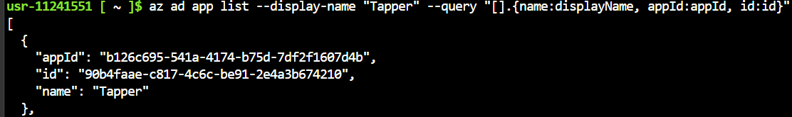

The application ID was identified as `b126c695-541a-4174-b75d-7df2f1607d4b`.

The application ID identifies the application to Microsoft Entra ID during authentication. It is distinct from the application's object ID, which identifies its directory object.

## Adding an Application Client Secret

The next step involved adding a client secret to the Tapper application registration.

A client secret is a credential used by an application to authenticate itself to Microsoft Entra ID. It functions similarly to an application password and is used alongside the application ID during authentication.

The following command was executed:

```bash
az ad app credential reset --id b126c695-541a-4174-b75d-7df2f1607d4b --append --display-name "0123hacker" --years 1
```

Command breakdown:
- `az ad app credential reset`: Creates or resets an application credential.
- `--id`: Specifies the application ID or object ID of the target application.
- `--append`: Adds the new credential without removing existing credentials.
- `--display-name "0123hacker"`: Assigns a descriptive name to the new credential.
- `--years 1`: Sets the credential's validity period to one year.

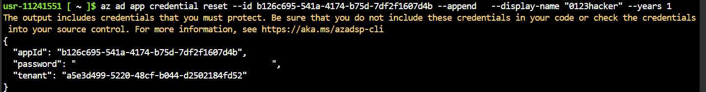

The command returned the newly generated client secret, linked to the `a5e3d499-5220-48cf-b044-d2502184fd52` tenant. Its value was required for the next authentication step.

**Important**: The client secret value is displayed only when it is generated. It should be stored securely and must not be included in a report or committed to a repository.

## Obtaining an Application-Only Access Token

With the application ID and newly generated client secret, an application-only access token was requested from Microsoft Entra ID.

The authentication used the OAuth 2.0 client credentials flow. This flow allows an application to authenticate using its own credentials rather than acting on behalf of a signed-in user.

The following request was sent:

```bash
    curl -X POST \
    https://login.microsoftonline.com/a5e3d499-5220-48cf-b044-d2502184fd52/oauth2/v2.0/token \
    -H "Content-Type: application/x-www-form-urlencoded" \
    -d "client_id=b126c695-541a-4174-b75d-7df2f1607d4b" \
    -d "client_secret=<REDACTED>" \
    -d "grant_type=client_credentials" \
    -d "scope=https://graph.microsoft.com/.default"
```

Command breakdown:
- `curl`: Sends an HTTP request.
- `-X POST`: Specifies the HTTP POST method.
- `https://login.microsoftonline.com/a5e3d499-5220-48cf-b044-d2502184fd52/oauth2/v2.0/token`: The Microsoft Entra ID OAuth 2.0 token endpoint for the specified tenant.
- `-H "Content-Type: application/x-www-form-urlencoded"`: Specifies that the request body contains URL-encoded form parameters.
- `client_id`: Identifies the application.
- `client_secret`: Supplies the application's credential.
- `grant_type=client_credentials`: Selects the OAuth 2.0 client credentials flow.
- `scope=https://graph.microsoft.com/.default`: Requests the Microsoft Graph application permissions that have been configured and consented to for the application.

The response contained an access token and its associated metadata.

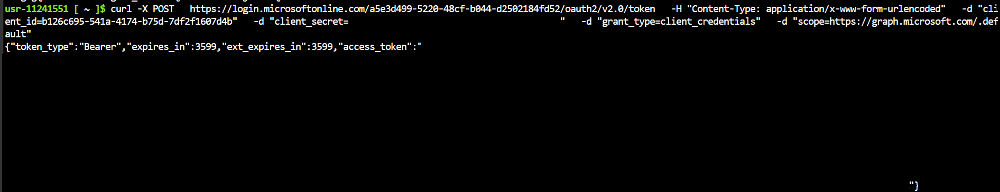

The access token was saved in a shell variable named `TOKEN` for use in subsequent Microsoft Graph requests.

```bash
TOKEN=<paste_access_token>
```
The token was then supplied in the Authorization header of subsequent requests.

An application-only token represents the application itself, rather than `Gumby` or another user. Its effective permissions depend on the application's configured application permissions and the consent granted by an administrator.

## Creating Temporary Access Passes for `Goo` and `Pokey`

The application token was used to create a Temporary Access Pass for the `Goo` account through Microsoft Graph.

The following request was executed:

```bash
curl -X POST \
https://graph.microsoft.com/v1.0/users/goo@201618.onmicrosoft.com/authentication/temporaryAccessPassMethods \
-H "Authorization: Bearer $TOKEN" \
-H "Content-Type: application/json" \
-d '{
        "lifetimeInMinutes": 60,
        "isUsableOnce": false
    }'
```

Request breakdown:

- `curl -X POST`: Sends an HTTP POST request to create a resource.
- `/users/goo@201618.onmicrosoft.com/authentication/temporaryAccessPassMethods`: Microsoft Graph endpoint for managing the user's Temporary Access Pass authentication methods.
- `Authorization: Bearer $TOKEN`: Supplies the application access token.
- `Content-Type: application/json`: Specifies that the request body contains JSON.
- `lifetimeInMinutes`: Sets the TAP validity period to 60 minutes.
- `isUsableOnce`: Determines whether the TAP can be used only once. Setting it to `false` allows multiple uses during its validity period.

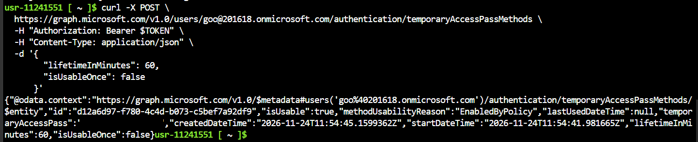

The response contained the newly generated Temporary Access Pass. Its value was recorded for the subsequent authentication step.

The same procedure was repeated for the `Pokey` account:

```bash
curl -X POST \
https://graph.microsoft.com/v1.0/users/pokey@201618.onmicrosoft.com/authentication/temporaryAccessPassMethods \
-H "Authorization: Bearer $TOKEN" \
-H "Content-Type: application/json" \
-d '{
        "lifetimeInMinutes": 60,
        "isUsableOnce": false
    }'
```

The request used the same parameters as the previous operation, with the target account changed to `pokey@201618.onmicrosoft.com`.

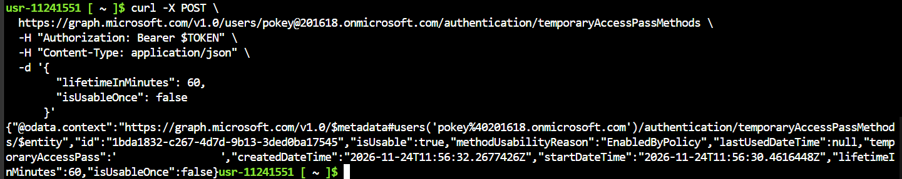

A Temporary Access Pass was returned for `Pokey` as well.

Both TAPs were configured with a validity period of 60 minutes and could be used multiple times during that period.

## Configuring Network Access Through `Goo`

With the TAP for `Goo` available, the account could be used to perform network-management operations.

The investigation returned to the `VM1VMNic` network interface identified during the initial enumeration.

The following configuration was performed:
1. From `All resources`, open the `VM1VMNic` network interface.
2. Navigate to IP configurations.
3. Select `ipconfigVM1`.
4. Enable Associate public IP address.
5. Create and associate a new public IP address.
6. Save the configuration.

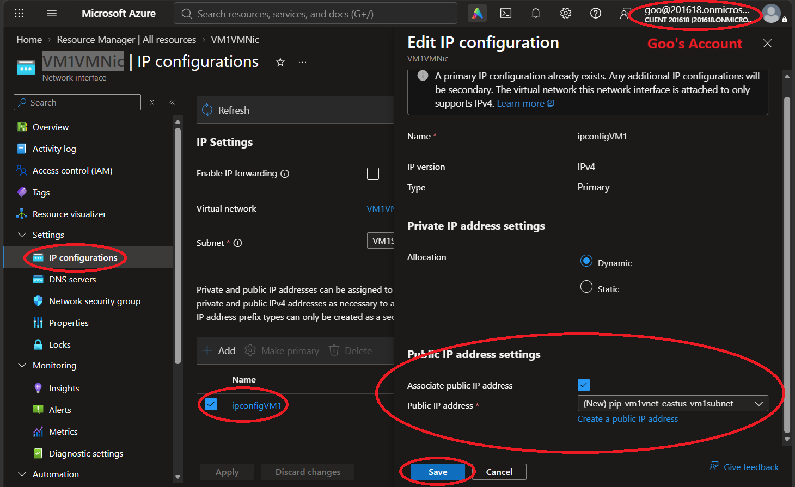

A public IP address allows a resource to be reached through an external network endpoint. However, associating a public IP does not automatically make the VM accessible. Network security rules must also permit the required inbound traffic.

Azure Standard SKU public IP addresses are secure by default. Inbound traffic is blocked unless explicitly allowed through an appropriate Network Security Group (NSG).

A Network Security Group is an Azure resource that contains inbound and outbound security rules. These rules control network traffic to and from associated network interfaces or subnets.

Since `Goo` had the `Network Contributor` role within the resource group, the account could manage the relevant networking resources.

The next step was to create an NSG allowing inbound SSH traffic.

## Creating a Network Security Group

In the Azure Portal, the Network Security Groups service was opened through the top search bar. The `+ Create` option was selected.

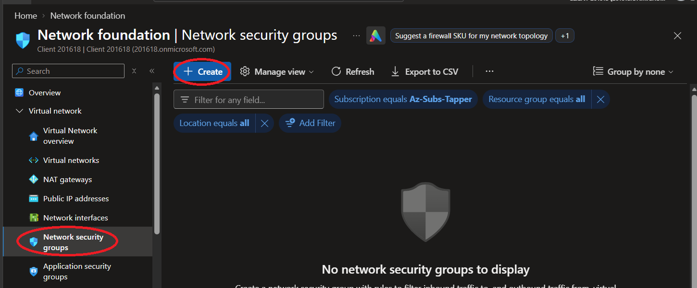

The following configuration was used:

| Setting | Value |
|---------|-------|
| Resource Group | rg-11241551 |
| Region | East US |
| Name | `nsg-vm1` |

After entering the configuration, `Review + create` was selected, followed by `Create`.

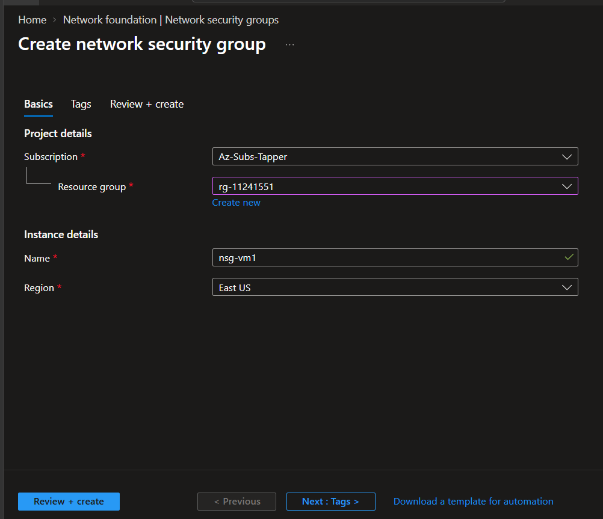

Once the NSG had been created, an inbound security rule was configured to permit SSH traffic.

The following settings were used:

| Setting | Value |
|---------|-------|
| Source | Any |
| Destination port ranges | 22 |
| Protocol | TCP |
| Action | Allow |
| Priority | 100 |
| Name | `Allow-SSH` |

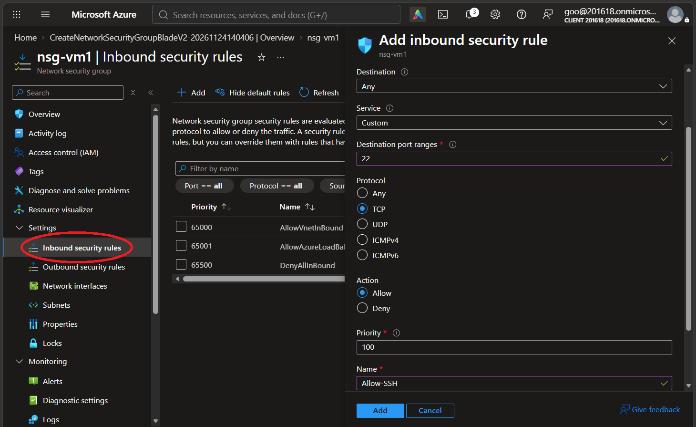

Port 22 is the default port used by SSH. The rule therefore permitted inbound TCP traffic destined for the SSH service.

The source was configured as `Any`, meaning that the rule allowed connections from any source IP address. This was broader than necessary and should be restricted to trusted source addresses in a properly secured environment.

Finally, the NSG was associated with the virtual machine's network interface.

Under the NSG's Network interfaces section, `+ Associate` was selected, followed by `VM1VMNic`.

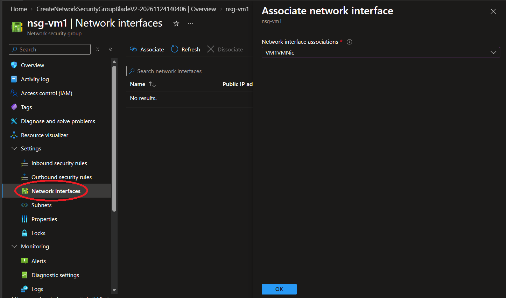

This association applied the NSG's rules to traffic entering and leaving the VM through the network interface.

## Assigning `VM1` Login Permissions Through `Pokey`

The next step involved using the `Pokey` account to grant the required virtual machine login permission.

The `VM1` resource was opened in the Azure Portal, followed by Access control (IAM).

The `+ Add` option was selected, followed by `Add role assignment`.

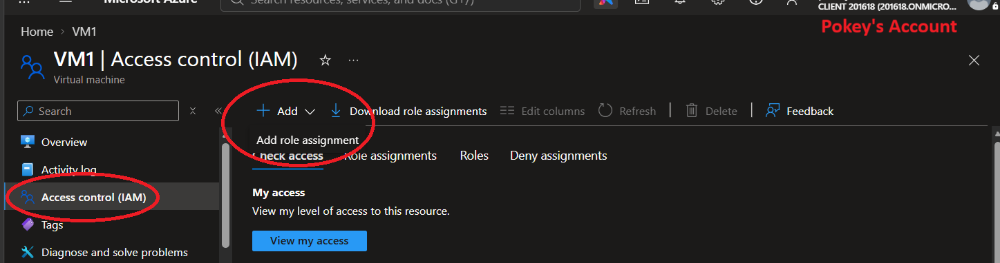

The role selection page provided two relevant options:
- `Virtual Machine Administrator Login`: Grants administrative login access to a virtual machine through Microsoft Entra ID.
- `Virtual Machine User Login`: Grants standard user login access to a virtual machine through Microsoft Entra ID.

The `Virtual Machine Administrator Login` role was selected in the lab. The `Virtual Machine User Login` role was also an available alternative, but it would provide a less privileged login.

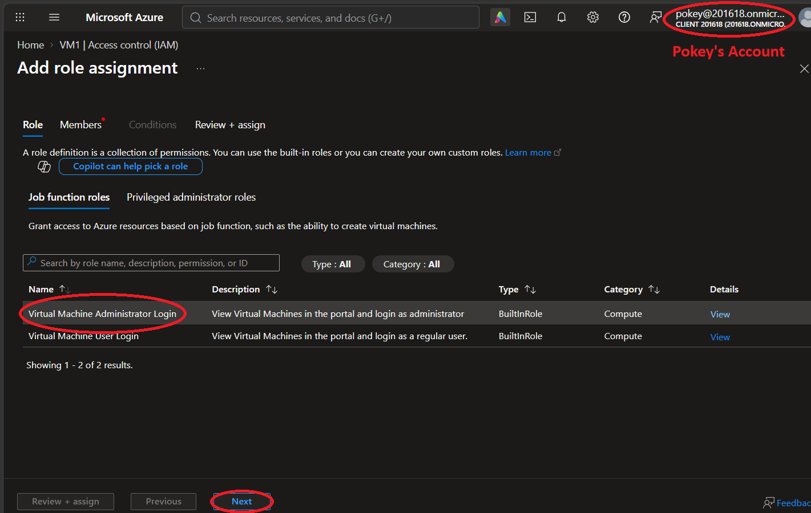

Under the member selection step, `User, group, or service principal` was chosen.

The `+ Select members` option was then used to select  `Pokey`'s account. Finally, `Review + assign` was clicked.

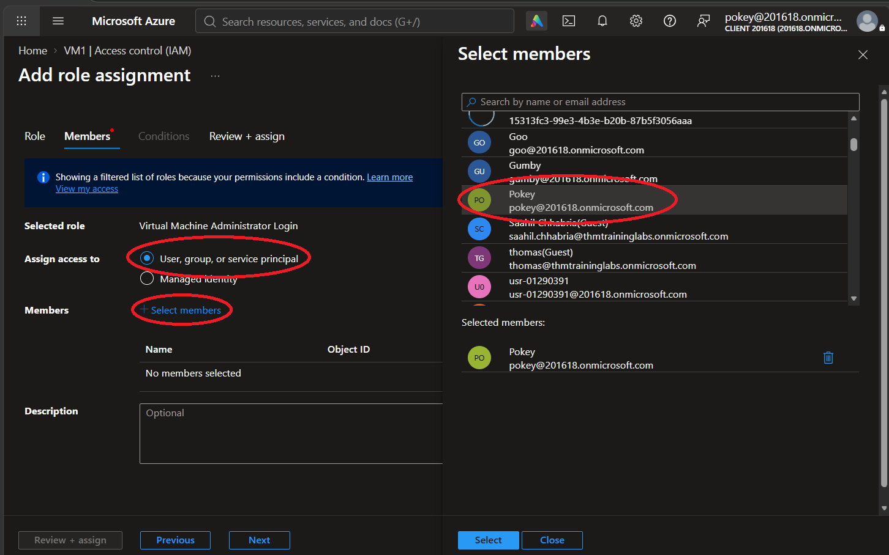

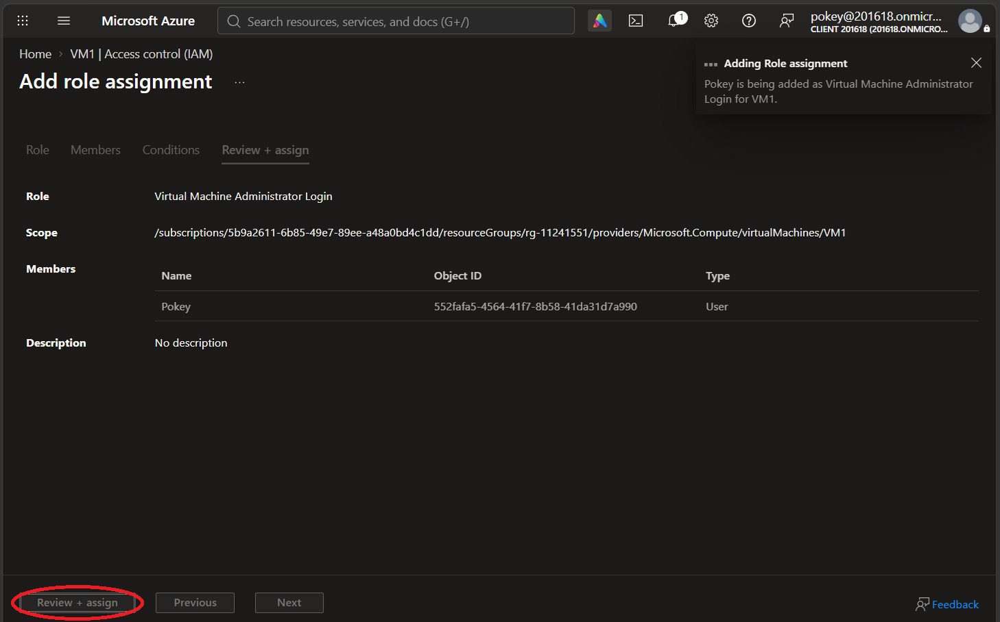

This assigned the selected VM login role to `Pokey` at the `VM1` resource scope.

The distinction between the two permissions was important: the `Virtual Machine Data Access Administrator` role enabled the management of VM login access, while the newly assigned `Virtual Machine Administrator Login` role provided the actual administrative login capability.

## Connecting to `VM1` and Retrieving the Flag

With network connectivity configured and the VM login role assigned, an SSH connection to `VM1` was established through Azure Cloud Shell.

The following Azure CLI command was used:

```bash
az ssh vm -g rg-11241551 -n VM1
```
Command breakdown:
- `az`: Runs Azure CLI.
- `ssh vm`: Establishes an SSH connection to an Azure virtual machine using Azure CLI's SSH functionality.
- `-g rg-11241551`: Specifies the resource group containing the virtual machine.
- `-n VM1`: Specifies the target virtual machine.

This command uses Azure's SSH integration and Microsoft Entra ID authentication when the required VM configuration and permissions are available.

After connecting successfully, the filesystem was searched for the flag file.

```bash
find / -type f -name "flag.txt" 2>/dev/null
```

Command breakdown:
- `find`: Searches for files and directories.
- `/`: Starts the search at the filesystem root.
- `-type f`: Restricts results to regular files.
- `-name "flag.txt"`: Searches for files with the exact name `flag.txt`.
- `2>/dev/null`: Redirects standard error to `/dev/null`, suppressing permission-denied and other error messages.

The search identified the flag at `/tmp/flag.txt`.

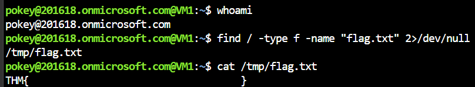

## Conclusion

The assessment demonstrated how multiple Azure permissions and an application registration could be combined to establish a path to a virtual machine.

The compromised password provided access to `Gumby`, who owned the `Tapper` application registration. Its Microsoft Graph application permission, `UserAuthenticationMethod.ReadWrite.All`, enabled the creation of Temporary Access Passes for `Goo` and `Pokey` after an application credential was added.

The `Goo` account's `Network Contributor` role provided the ability to modify the network configuration and expose the virtual machine through a public IP address and an NSG allowing SSH traffic. The `Pokey` account's `Virtual Machine Data Access Administrator` role enabled the assignment of a VM login role.

These capabilities were combined to establish SSH access to `VM1` and retrieve the flag.

The key takeaway was that seemingly separate permissions across application registrations, user authentication methods, network resources, and virtual machine access can form a complete attack path when combined.

## Remediation Recommendations

The following recommendations should be implemented to reduce the risk of Managed Identity abuse and excessive permissions within Azure environments.

| Finding | Recommendation |
|---------|----------------|
| **Excessive application permissions** | Apply least privilege to Microsoft Graph application permissions. Grant only the permissions required for the application's intended functionality. |
| **Ability to modify user authentication methods** | Restrict `UserAuthenticationMethod.ReadWrite.All` to applications with a documented business requirement. Review and audit application permission consent. |
| **Excessive application ownership** | Limit application ownership to trusted administrators and review owners regularly. |
| **Uncontrolled application credential management** | Restrict who can add application credentials. Monitor credential additions and removals, enforce short credential lifetimes, and prefer managed identities where appropriate. |
| **Unauthorized Temporary Access Pass creation** | Monitor authentication-method changes and Temporary Access Pass creation. Apply appropriate administrative restrictions and alert on unexpected TAP issuance. |
| **Excessive Network Contributor permissions** | Scope network-management permissions narrowly and avoid granting broad network-management access where more restrictive roles are sufficient. |
| **Insufficient monitoring of Azure changes** | Enable and review Azure Activity Logs and Microsoft Entra audit logs. Alert on application credential changes, TAP creation, network configuration changes, and RBAC role assignments.| 